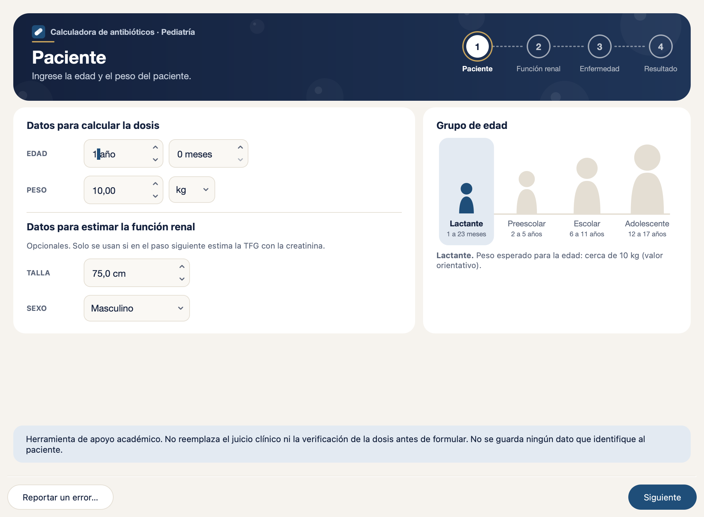
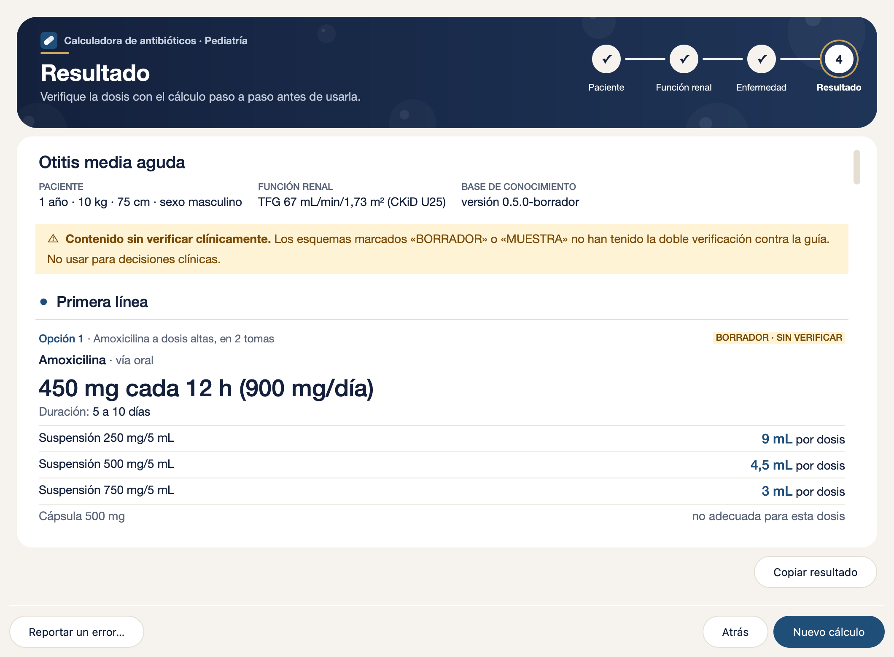

# Calculadora de dosis de antibióticos pediátricos

Prototipo del proyecto *Desarrollo de una calculadora de las dosis de
antibióticos para las enfermedades infecciosas prevalentes en la infancia*
(Universidad Militar Nueva Granada, convocatoria de prototipado 2025-2).

Calcula la dosis por peso y edad, aplica topes máximos, ajusta por función
renal (TFG), convierte a la presentación del medicamento y muestra el cálculo
desglosado con su fuente.

> **Estado: prototipo en desarrollo. NO usar para decisiones clínicas.**
> La base de conocimiento incluida está en **borrador**: los esquemas, los
> topes y el ajuste renal se extrajeron de guías colombianas e internacionales
> y de fichas técnicas, pero todavía no tienen la doble verificación clínica,
> y el programa lo advierte en cada resultado.

## Descargar los instaladores

Los instaladores están en la página de publicaciones del repositorio:
**[Releases → última versión](https://github.com/juvenalyosa/calculadora-antibioticos-pediatricos/releases/latest)**.
El repositorio es privado: para descargarlos hay que iniciar sesión en GitHub
con una cuenta que tenga acceso.

| Sistema | Archivo |
|---|---|
| Windows 10 u 11 (64 bits) | `CalculadoraAntibioticos-<versión>-windows-instalador.exe` o, sin instalar, `...-windows-portatil.zip` |
| Mac (Intel o Apple Silicon), macOS 12 o posterior | `CalculadoraAntibioticos-<versión>-macos.dmg` |
| Linux de 64 bits | `CalculadoraAntibioticos-<versión>-linux-x86_64.AppImage` |

Los pasos de instalación de cada sistema, incluido cómo abrirla la primera
vez (todavía no tiene firma digital), están en
[docs/instalacion.md](docs/instalacion.md).

Cada vez que cambia el empaquetado, el flujo *Paquetes* de la pestaña
[Actions](https://github.com/juvenalyosa/calculadora-antibioticos-pediatricos/actions/workflows/paquetes.yml)
también deja los instaladores como artefactos de esa ejecución (se borran a
los 90 días). Cómo se construyen y cómo publicar una versión nueva:
[docs/empaquetado.md](docs/empaquetado.md).

## Inicio rápido

Requisitos: CMake 3.21 o superior, un compilador de C++17 (clang, GCC o MSVC)
y, para regenerar los datos, Python 3.9 o superior.

```sh
cmake --preset dev            # configurar
cmake --build --preset dev    # compilar
ctest --preset dev            # ejecutar todas las pruebas
```

Calcular el caso tipo 1 de la validación alfa (lactante de 1 año, 10 kg, 75 cm):

```sh
./build/dev/src/cli/calc-dosis calcular --enfermedad oma \
    --edad-anios 1 --peso-kg 10 --talla-cm 75 --sexo m --creatinina 0,4
```

Con `--creatinina` la función renal se estima con la ecuación CKiD U25, que
necesita talla y sexo; `--formula schwartz` usa Schwartz de cabecera (solo
talla).

Otras órdenes: `calc-dosis listar`, `calc-dosis validar`, `calc-dosis ayuda`.

### Interfaz gráfica

La interfaz por pasos necesita Qt 6.5 o superior (módulo Widgets). Si CMake no
encuentra Qt, compila todo lo demás y omite la interfaz. Para indicarle dónde
está, la primera vez:

```sh
cmake --preset dev -DCMAKE_PREFIX_PATH=$HOME/Qt/6.8.3/macos   # ajustar la ruta
cmake --build --preset dev
open build/dev/src/gui/CalculadoraAntibioticos.app            # macOS
```

Los pasos son paciente → función renal → enfermedad → resultado, y en todos
hay un botón «Reportar un error…». La interfaz sigue el modo claro u oscuro
del sistema; se puede forzar con `--tema claro` o `--tema oscuro`. Las
imágenes de `docs/capturas/` se regeneran con `--tema claro --capturas
<carpeta>`.

| | |
|---|---|
|  |  |

## Estructura del repositorio

```
├── CMakeLists.txt            construcción (raíz)
├── CMakePresets.json         configuraciones: dev y release
├── cmake/                    módulos de CMake
├── data/
│   ├── fuente/               hojas CSV que edita el equipo clínico  ← fuente de verdad
│   └── kb/                   base de conocimiento JSON (GENERADA, no editar)
├── docs/                     arquitectura, guía de datos, validación alfa
├── src/
│   ├── core/                 biblioteca calc_core: todo el dominio
│   │   ├── include/calc/     interfaz pública (documentada)
│   │   └── src/              implementación
│   ├── cli/                  programa de consola calc-dosis
│   └── gui/                  interfaz gráfica por pasos (Qt 6 Widgets)
├── tests/                    pruebas automáticas y matriz de validación alfa
├── tools/                    construir_kb.py (CSV → JSON)
└── third_party/              bibliotecas de terceros y sus licencias
```

## Cómo fluyen los datos clínicos

```
hojas de cálculo ──exportar──> data/fuente/*.csv
                                    │  python3 tools/construir_kb.py
                                    ▼
                          data/kb/base_conocimiento.json
                                    │  calc-dosis validar
                                    ▼
                               motor de dosis
```

Agregar una enfermedad o un antibiótico **no requiere programar**: se añaden
filas a las hojas y se regenera la base. Ver [docs/guia_datos.md](docs/guia_datos.md).

## Documentación

| Documento | Para quién | Contenido |
|---|---|---|
| [docs/arquitectura.md](docs/arquitectura.md) | Desarrolladores | Módulos, orden del cálculo, reglas de diseño y cómo extender (incluida IA) |
| [docs/guia_datos.md](docs/guia_datos.md) | Equipo clínico y asistentes | Cómo llenar las hojas y qué significa cada columna |
| [docs/revision/protocolo.md](docs/revision/protocolo.md) | Equipo clínico e investigadores | Revisión de alcance de guías: búsqueda, cribado, extracción e integración ([flujo PRISMA](docs/revision/flujo_prisma.md)) |
| [docs/validacion/LEEME.md](docs/validacion/LEEME.md) | Equipo clínico y desarrolladores | Prueba exhaustiva con población modelada con los patrones de la OMS |
| [docs/instalacion.md](docs/instalacion.md) | Usuarios | Cómo instalar la calculadora en Windows, Mac y Linux |
| [docs/empaquetado.md](docs/empaquetado.md) | Desarrolladores | Cómo se construyen los instaladores y cómo publicar una versión |
| [docs/validacion_alfa.md](docs/validacion_alfa.md) | Equipo clínico | Cómo construir la matriz de validación con los dos casos tipo |

Las cabeceras de `src/core/include/calc/` están comentadas en formato Doxygen
y sirven de base para el manual técnico.

## Convenciones

- **Idioma.** Identificadores del código en inglés (convención del lenguaje);
  comentarios, documentación, mensajes al usuario y nombres de columnas y
  claves de los datos en español. La correspondencia entre ambos está en
  `src/core/src/kb_loader.cpp` y en la guía de datos.
- **Formato.** `clang-format` con el archivo `.clang-format` de la raíz.
- **Advertencias.** El preset `dev` trata las advertencias como errores.
- **Pruebas.** Todo cambio en el motor va con su prueba; todo cambio en los
  datos clínicos va con su fila en la matriz alfa.
- **Versiones.** Hay tres, independientes: la de la aplicación
  (`CMakeLists.txt`), la del contenido clínico (`data/fuente/metadatos.json`)
  y la de la forma de los datos (`esquema_version`).

Para que el editor (clangd) reconozca el proyecto, apúntelo a
`build/dev/compile_commands.json`, que se genera al configurar.

## Titularidad

De acuerdo con el documento de radicación del proyecto, la titularidad de los
derechos de propiedad intelectual corresponde a la Universidad Militar Nueva
Granada. Las bibliotecas de terceros conservan sus propias licencias (ver
[third_party/README.md](third_party/README.md)).
